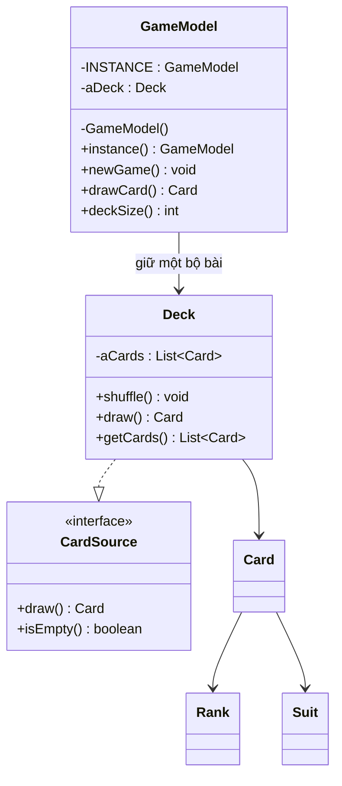

# Post-Class 05: Exercise 9

| Thông tin | Nội dung |
|---|---|
| Họ và tên | Huỳnh Ngọc Khang |
| MSSV | 4651050116 |
| Lớp | CNTT46D |
| Bài | Thiết kế lại `GameModel` dùng Singleton |

## Đề bài

Thiết kế `GameModel` theo mẫu Singleton. Lớp có một biến thể hiện kiểu `Deck` và khởi tạo lại bộ bài mỗi khi gọi `newGame()`. Phần `GameModel` có thể chỉ là stub; ở đây mình bổ sung thao tác rút bài để minh họa trạng thái được chia sẻ.

## Thiết kế



## Cách cài đặt Singleton

Trong `GameModel`, `INSTANCE` là biến `static final`, nên lớp giữ một đối tượng duy nhất. Constructor được đặt `private`, vì vậy mã bên ngoài không thể gọi `new GameModel()`. Các nơi cần dùng model gọi `GameModel.instance()` để nhận lại cùng đối tượng.

`aDeck` là biến thể hiện duy nhất có kiểu `Deck`. `newGame()` gọi `aDeck.shuffle()`: phương thức này xóa các lá cũ, tạo lại đủ 52 lá rồi xáo thứ tự. Như vậy ván mới dùng lại chính đối tượng `Deck` đang thuộc `GameModel`, nhưng có trạng thái bộ bài mới.

Các lớp `Card`, `Rank`, `Suit`, `CardSource` và `Deck` trong `e3.chapter3` được lấy từ phần mã nguồn sách đã có trong [repo tham khảo của Anh Khoa](https://github.com/AnhKhoa06/postclass05_singleton). README của repo đó ghi nguồn là [DesignBook của Martin P. Robillard](https://github.com/prmr/DesignBook), thư mục `code-e3/e3/chapter3`. Mình giữ nguyên phần `e3` này; `GameModel`, `Main` và phần trình bày bên ngoài là phần bài làm của mình.

`Deck.getCards()` trả về danh sách không thể sửa trực tiếp, nên `GameModel.deckSize()` dùng danh sách này để minh họa số lá còn lại.

## Chương trình minh họa

`Main` gọi `instance()` hai lần và so sánh hai tham chiếu. Sau đó chương trình bắt đầu ván, rút một lá qua `first`, rồi kiểm tra số lá qua `second`. Cuối cùng, `newGame()` được gọi lần nữa để cho thấy bộ bài trở lại 52 lá.

Các dòng ổn định trong kết quả:

```text
first == second: true
So la khi bat dau: 52
La bai vua rut: <la bai ngau nhien>
So la xem qua second: 51
So la sau khi bat dau van moi: 52
```

Lá rút ra thay đổi theo lần chạy vì bộ bài được xáo ngẫu nhiên.

## Chạy trong Eclipse

Chạy lớp `singleton.Main`. Project dùng `src` làm source folder và không cần thư viện ngoài.
