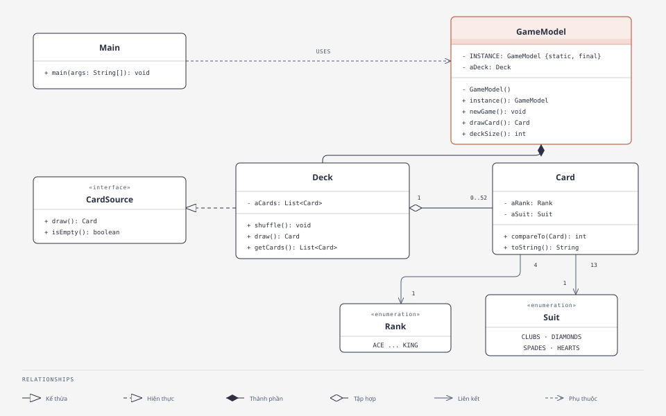

# Post-Class 05: Exercise 9

| Thông tin | Nội dung |
|---|---|
| Họ và tên | Huỳnh Ngọc Khang |
| MSSV | 4651050116 |
| Lớp | CNTT46D |
| Bài | Thiết kế lại `GameModel` dùng Singleton |

## Yêu cầu

Thiết kế `GameModel` theo Singleton. Lớp có một biến thể hiện kiểu `Deck`; mỗi lần gọi `newGame()` thì bộ bài được khởi tạo lại. Phần `GameModel` có thể để dạng stub.

## Thiết kế



[Mở bản sơ đồ HTML](diagrams/exercise-9-class-diagram.html).

## Giải pháp

`GameModel` giữ một đối tượng trong `INSTANCE`. Constructor `private` ngăn nơi khác gọi `new GameModel()`, còn `instance()` luôn trả về đối tượng đó.

`aDeck` là bộ bài duy nhất của model. Khi bắt đầu ván, `newGame()` gọi `shuffle()`, hàm này tạo lại 52 lá rồi xáo chúng. Mình thêm `drawCard()` và `deckSize()` để Main có thể minh họa việc hai tham chiếu cùng nhìn thấy trạng thái bộ bài.

Các lớp `Card`, `CardSource`, `Deck`, `Rank` và `Suit` được giữ nguyên từ [repo tham khảo](https://github.com/AnhKhoa06/postclass05_singleton). README ở đó dẫn nguồn đến [DesignBook của Martin P. Robillard](https://github.com/prmr/DesignBook), thư mục `code-e3/e3/chapter3`. `GameModel` và `Main` là phần mình viết cho bài này.

## Kết quả chạy

Main gọi `instance()` hai lần rồi rút một lá qua `first`. Qua `second`, bộ bài còn 51 lá, cho thấy cả hai tham chiếu dùng chung trạng thái. Gọi `newGame()` lần nữa thì bộ bài có lại 52 lá.

Kết quả chính:

```text
first == second: true
So la khi bat dau: 52
La bai vua rut: <la bai ngau nhien>
So la xem qua second: 51
So la sau khi bat dau van moi: 52
```

Lá rút ra thay đổi theo lần chạy vì bộ bài được xáo ngẫu nhiên.

## Chạy

Trong Eclipse, chạy `singleton.Main`. Project dùng `src` làm source folder.
