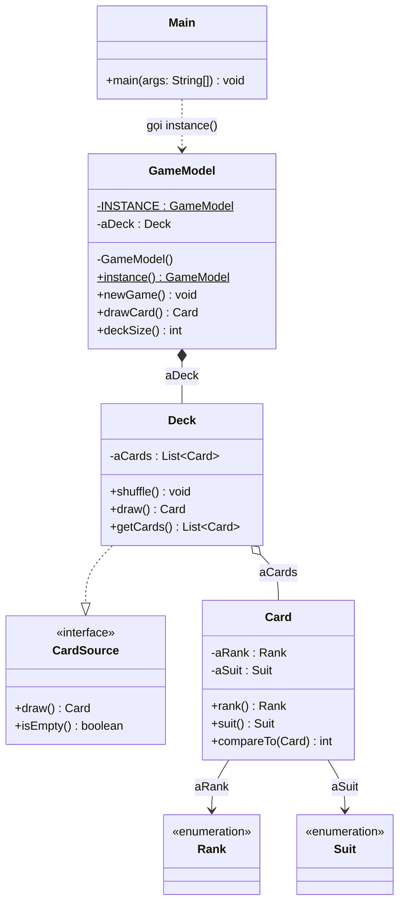

# Post-Class 05: Exercise 9

| Thông tin | Nội dung |
|---|---|
| Họ và tên | Huỳnh Ngọc Khang |
| MSSV | 4651050116 |
| Lớp | CNTT46D |
| Bài | Thiết kế lại `GameModel` dùng Singleton |

## 1. Đề bài

Thiết kế `GameModel` theo mẫu Singleton. Lớp có một biến thể hiện kiểu `Deck`; mỗi lần gọi `newGame()`, bộ bài cần được khởi tạo lại. Theo yêu cầu, phần `GameModel` có thể chỉ là stub.

## 2. Giải pháp

### 2.1. Sơ đồ lớp



### 2.2. Mã nguồn `GameModel`

```java
package singleton;

import e3.chapter3.Card;
import e3.chapter3.Deck;

public final class GameModel {
    private static final GameModel INSTANCE = new GameModel();
    private final Deck aDeck = new Deck();

    private GameModel() {
    }

    public static GameModel instance() {
        return INSTANCE;
    }

    public void newGame() {
        aDeck.shuffle();
    }

    public Card drawCard() {
        return aDeck.draw();
    }

    public int deckSize() {
        return aDeck.getCards().size();
    }
}
```

### 2.3. Bốn phần của Singleton

1. `private static final GameModel INSTANCE`: biến tĩnh giữ đối tượng duy nhất.
2. `private GameModel()`: constructor riêng, ngăn mã bên ngoài gọi `new GameModel()`.
3. `public static GameModel instance()`: cách duy nhất để lấy model.
4. `private final Deck aDeck`: bộ bài thuộc về model và được dùng lại giữa các ván.

## 3. Giải thích

`INSTANCE` được tạo khi lớp `GameModel` được nạp. Java chỉ khởi tạo lớp một lần, vì vậy những lần gọi `instance()` đều nhận cùng một đối tượng.

`newGame()` gọi `Deck.shuffle()`. Hàm này xóa các lá hiện tại, tạo đủ 52 lá từ các giá trị `Rank` và `Suit`, rồi xáo thứ tự. `Deck` được dùng lại; trạng thái bên trong được đặt về bộ bài mới.

Mình thêm `drawCard()` và `deckSize()` để phần `Main` kiểm tra trạng thái dùng chung. Hai tham chiếu `first` và `second` trỏ đến cùng `GameModel`, nên rút bài qua `first` cũng làm số lá quan sát được qua `second` giảm đi.

## 4. Code minh họa và kết quả

`Main` gọi `instance()` hai lần, bắt đầu ván, rút một lá rồi bắt đầu ván mới lần nữa.

```java
package singleton;

public class Main {
    public static void main(String[] args) {
        GameModel first = GameModel.instance();
        GameModel second = GameModel.instance();

        System.out.println("first == second: " + (first == second));

        first.newGame();
        System.out.println("So la khi bat dau: " + first.deckSize());
        System.out.println("La bai vua rut: " + first.drawCard());
        System.out.println("So la xem qua second: " + second.deckSize());

        second.newGame();
        System.out.println("So la sau khi bat dau van moi: " + first.deckSize());
    }
}
```

```text
first == second: true
So la khi bat dau: 52
La bai vua rut: <la bai ngau nhien>
So la xem qua second: 51
So la sau khi bat dau van moi: 52
```

Lá rút ra thay đổi giữa các lần chạy do `Deck` được xáo ngẫu nhiên.

## 5. Cấu trúc project

```text
Postclass05
├── .classpath
├── .gitignore
├── .project
├── README.md
└── src
    ├── e3
    │   └── chapter3
    │       ├── Card.java
    │       ├── CardSource.java
    │       ├── Deck.java
    │       ├── Rank.java
    │       └── Suit.java
    └── singleton
        ├── GameModel.java
        └── Main.java
```

Các lớp `Card`, `CardSource`, `Deck`, `Rank` và `Suit` trong `e3.chapter3` được giữ nguyên từ mã nguồn đi kèm sách *Introduction to Software Design with Java* của Martin P. Robillard. Có thể tìm chúng trong thư mục `code-e3/e3/chapter3` của [repository DesignBook](https://github.com/prmr/DesignBook).

Trong Eclipse, chạy lớp `singleton.Main`.
